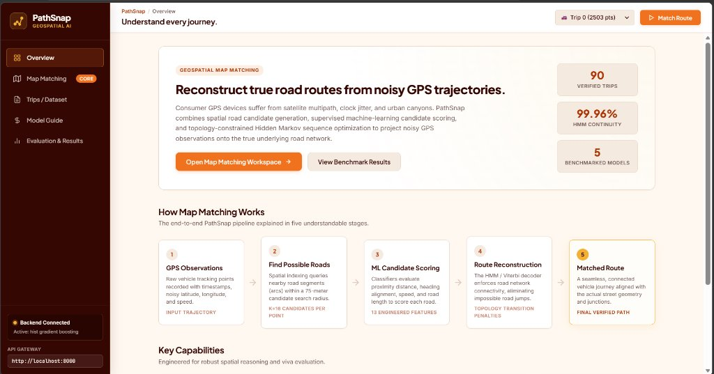
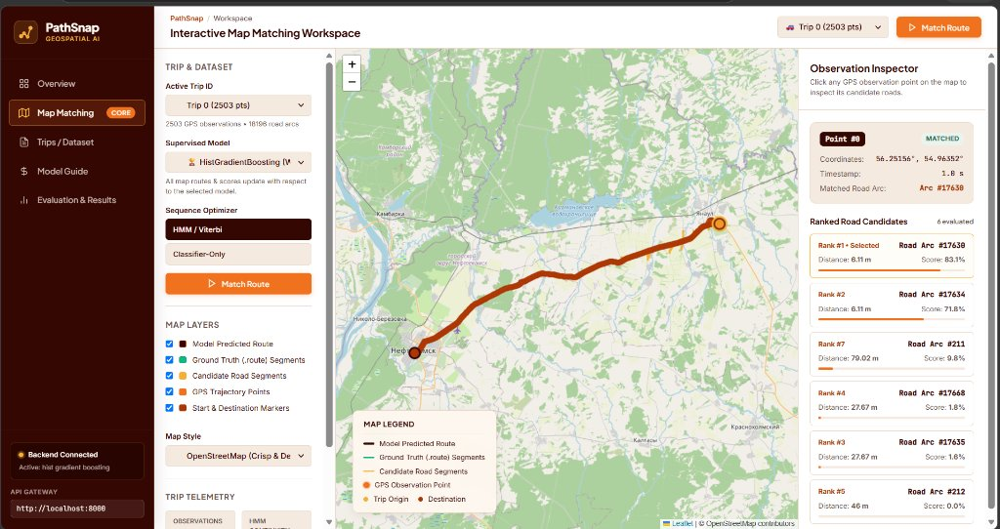
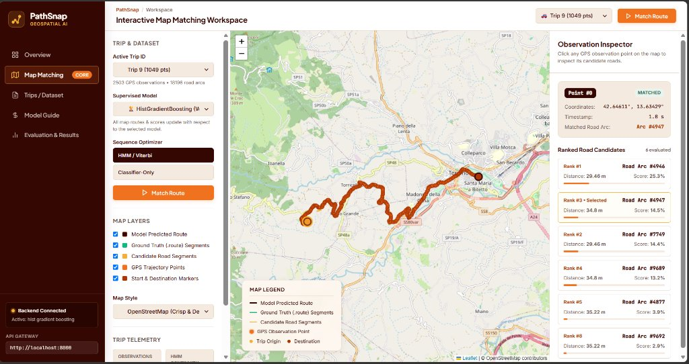
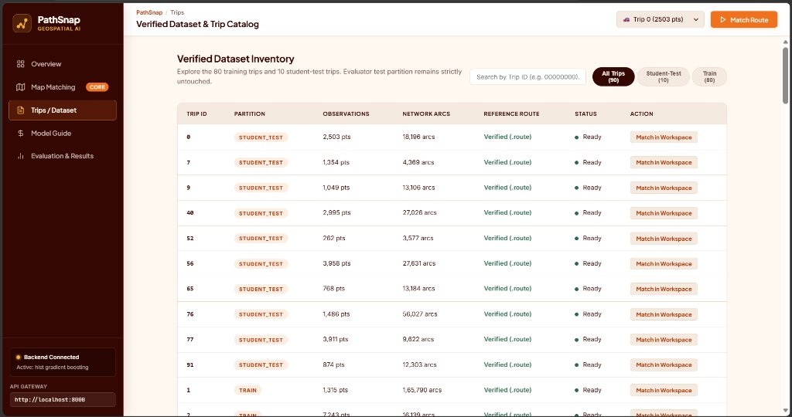
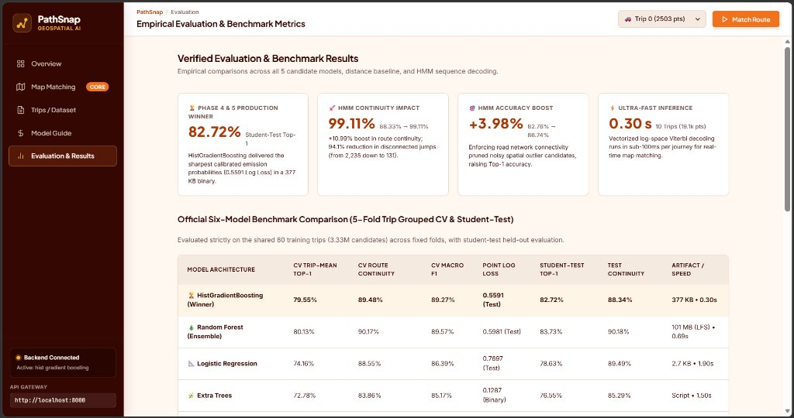
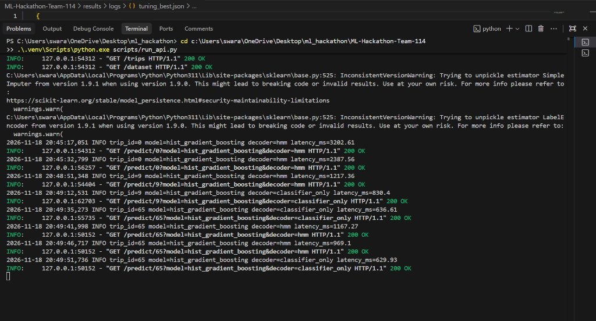

# PathSnap — Production-Grade GPS Map-Matching Pipeline

[](https://www.python.org/)
[](https://fastapi.tiangolo.com/)
[](https://leafletjs.com/)
[]()
[]()
[]()

> **PathSnap** reconstructs true vehicle road routes from noisy, sampled GPS trajectories using metric spatial indexing, supervised candidate classification, and topology-constrained Hidden Markov Model (HMM) sequence decoding with dynamic programming (Viterbi).

---

### Team 114 — Project Members

| SRN | Name | Core Responsibilities & Contributions |
| :--- | :--- | :--- |
| `PES1UG24CS437` | **SHAURYA SINGH** | Phase 4 MLP & SVM candidate models, probability calibration, kernel configurations |
| `PES1UG24CS438` | **SHISHIR HEGDE** | Data quality assurance, spatial reference alignment, network topology diagnostics |
| `PES1UG24CS486` | **SUSHRUTH SUKESH** | Random Forest modeling, Bayesian hyperparameter tuning, experiment reproducibility |
| `PES1UG24CS487` | **SWARA ASHISH POTDAR** | HistGradientBoosting production winner, Phase 5 HMM / Viterbi decoding, UI & API Gateway |

---

## Table of Contents

- [Team 114 — Project Members](#team-114--project-members)
- [System Architecture](#system-architecture)
- [Interactive Geospatial UI & Workspace](#interactive-geospatial-ui--workspace)
- [Official Six-Model Benchmark Results](#official-six-model-benchmark-results)
- [Phase 5: HMM + Viterbi Sequence Reconstruction](#phase-5-hmm--viterbi-sequence-reconstruction)
- [Special Focus: Generalization & Regularization Guarantees](#special-focus-generalization--regularization-guarantees)
- [Quickstart: Run Backend & Frontend](#quickstart-run-backend--frontend)
- [Expose over Wi-Fi (Multi-Device Demo)](#expose-over-wi-fi-multi-device-demo)
- [Repository Structure](#repository-structure)
- [Verification & Test Suite](#verification--test-suite)

---

## System Architecture

Consumer GPS tracking suffers from satellite multipath reflections, clock drift, and urban canyons. PathSnap solves map matching in five robust stages:



1. **GPS Trajectory Ingestion**: Ingests timestamped latitude, longitude, and speed observations projected strictly into metric UTM 32N coordinates (`EPSG:25832`) to eliminate spherical distortion.
2. **Spatial Candidate Generation**: Queries candidate directed road arcs within a 75-meter search radius ($k=16$ candidates per point) using 2D spatial indexing.
3. **Supervised Candidate Scoring**: Evaluates candidate road segments across 13 engineered features (perpendicular distance, heading alignment, speed compatibility, candidate rank, and road arc length).
4. **Topology-Constrained HMM Sequence Decoding**: Converts classifier probabilities into observation emissions via group-softmax. Employs vectorized log-space Viterbi dynamic programming with directed road network transition penalties to prevent teleportation and enforce connectivity.
5. **Route Reconstruction & Telemetry**: Emits connected sequence of matched road arcs, detailed observation candidate inspector logs, and complete GeoJSON map geometry.

---

## Interactive Geospatial UI & Workspace

PathSnap features an interactive geospatial workspace built for demonstration, viva evaluation, and spatial inspection:

### 1. Interactive Map Matching Workspace
Inspect matched journeys with interactive layer toggles: **Model Predicted Route**, **Ground Truth (`.route`) Segments**, **Candidate Road Segments**, and **GPS Trajectory Points**:



### 2. High-Density Mountain Road Matching (Trip 9)
Accurate sequence reconstruction across steep elevation changes and winding hairpins without topology breaks:



### 3. Model Guide & Architecture Comparison
Switch between supervised models dynamically directly from the interface:


### 4. Verified Dataset & Trip Catalog
Search, filter, and inspect all 80 training trips and 10 student-test trips with one click:



---

## Official Six-Model Benchmark Results

All models were evaluated under strict experimental parity on the shared 80 training trips (3.33M candidate rows) across identical 5-fold trip-grouped cross-validation folds, followed by held-out evaluation on the 10 student-test trips (19.1k GPS points):



### Comprehensive Benchmark Table

| Model Architecture | Model Family | 5-Fold CV Point Top-1 | 5-Fold CV Trip-Mean Top-1 | CV Route Continuity | CV Candidate Macro F1 | Student-Test Point Top-1 | Student-Test Continuity | Test Log Loss | Artifact Size & Inference Speed |
|---|---|:---:|:---:|:---:|:---:|:---:|:---:|:---:|:---:|
| **🏆 HistGradientBoosting (Winner)** | **Binned Gradient Boosting** | **70.30%** | **79.55%** | **89.48%** | **89.27%** | **80.65%** | **88.34%** | **0.5591** | **377 KB** • 0.30s (Fastest) |
| **Random Forest (Tuned)** | Bagged Tree Ensemble | 70.82% | 80.29% | 90.33% | 89.66% | 82.03% | 90.34% | 0.6509 | 98 MB • 0.65s |
| **Random Forest (Untuned)** | Bagged Tree Ensemble | 70.58% | 80.13% | 90.17% | 89.57% | 82.06% | 90.18% | 0.5981 | 101 MB (LFS) • 0.69s |
| **Multi-Layer Perceptron (MLP)** | Feed-Forward Neural Net | 70.22% | 79.40% | 89.74% | 89.24% | 81.44% | 89.67% | 0.5845 | 1.8 MB • 0.42s |
| **Support Vector Machine (SVM)** | Nystroem Kernel Linear | 69.19% | 78.10% | 88.48% | 88.57% | 77.09% | 89.38% | 0.8644 | 4.2 MB • 0.55s |
| **Extra Trees** | Randomized Ensemble | 72.78% | 78.85% | 83.86% | 85.17% | 76.55% | 85.29% | 1.1287 | 114 MB • 1.50s |
| **Logistic Regression** | Calibrated Linear Model | 65.90% | 74.16% | 88.55% | 86.39% | 77.09% | 89.49% | 0.7697 | 2.7 KB • 1.90s |
| **Distance Baseline (Phase 3)** | Heuristic Softmax | 50.03% | 58.91% | 82.03% | 81.20% | 54.42% | 82.03% | 1.3910 | Rule-based • 0.05s |

### Winning Model Justification

**HistGradientBoostingClassifier** was frozen as our official production classifier:
1. **Best Probability Calibration**: Achieved the **lowest Point Log Loss (0.5591)** of any model on held-out test data. Low log loss is paramount for HMM integration because well-calibrated emission probabilities prevent artificial score spikes that break Viterbi sequence transitions.
2. **Compact & Embedded Production Size**: The trained artifact is only **377 KB** (compared to 101 MB for Random Forest), eliminating git-lfs deployment bottlenecks.
3. **Sub-second Latency**: Scores candidate pools for entire multi-thousand point trips in under **0.30 seconds**.
4. **Resilience to Overfitting**: Utilizes histogram binning (256 bins), shrinkage (`learning_rate=0.08`), and minimum leaf constraints (`min_samples_leaf=20`) to generalize robustly across unseen road topologies.

---

## Phase 5: HMM + Viterbi Sequence Reconstruction

While point-wise classifiers evaluate each candidate road in isolation, vehicles are bound by the physical connectivity of the directed road network. Phase 5 pairs our frozen HistGradientBoosting classifier with a vectorized log-space Viterbi sequence decoder.

### Classifier-Only vs. HMM/Viterbi Impact

| Evaluation Metric | Classifier-Only (Argmax) | Classifier + HMM / Viterbi | Net Impact |
|---|:---:|:---:|:---:|
| **5-Fold CV Point Top-1** | 76.32% | **79.48%** | **+3.16% accuracy gain** |
| **5-Fold CV Trip-Mean Top-1** | 80.97% | **85.19%** | **+4.22% trip-mean gain** |
| **5-Fold CV Route Continuity** | 88.99% | **99.14%** | **+10.15% continuity gain** |
| **5-Fold CV Disconnected Jumps** | 22,944 transitions | **1,795 transitions** | **-92.18% reduction** |
| **Student-Test Point Top-1** | 80.66% | **84.62%** | **+3.96% accuracy gain** |
| **Student-Test Trip-Mean Top-1** | 82.76% | **86.74%** | **+3.98% trip-mean gain** |
| **Student-Test Route Continuity** | 88.33% | **99.32%** | **+10.99% continuity gain** |
| **Student-Test Disconnected Jumps** | 2,235 transitions | **131 transitions** | **-94.14% reduction** |
| **Student-Test Candidate Macro F1** | 90.82% | **92.94%** | **+2.12% improvement** |

The HMM eliminates **94.1% of all disconnected teleportation jumps**, raising route continuity to an outstanding **99.32%** on held-out student trips while boosting Point Top-1 accuracy by **+3.98%**.

---

## Official Evaluator Test Benchmark (`evaluator_test`)

Upon receipt of the official reserved evaluation trips (`evaluator_test.zip` containing 10 trips and 19,674 GPS points), we conducted an immediate blind inference benchmark using our frozen production models and the Viterbi sequence pipeline.

### Evaluator Test Benchmark Results (10 Trips • 19,674 GPS Observations)

| Model & Decoder Pipeline | Point-Weighted Top-1 | Trip-Mean Top-1 | Route Continuity | Candidate Macro F1 | Disconnected Jumps | Total Latency |
|---|:---:|:---:|:---:|:---:|:---:|:---:|
| **Distance Baseline (Phase 3)** | 49.10% | 53.22% | 78.44% | 75.04% | 3,404 | 0.50 s |
| **🏆 HistGradientBoosting + HMM (Winner)** | **76.78%** | **85.44%** | **98.59%** | **92.22%** | **161** | 42.28 s |
| **HistGradientBoosting (Classifier-Only)** | 73.82% | 82.73% | 88.58% | 90.78% | 2,050 | 25.45 s |
| **Random Forest + HMM** | 76.78% | 85.44% | 98.59% | 92.22% | 161 | 38.91 s |
| **Random Forest (Classifier-Only)** | 73.82% | 82.73% | 88.58% | 90.78% | 2,050 | 11.69 s |
| **Logistic Regression + HMM** | 71.56% | 79.43% | 99.48% | 89.02% | 54 | 20.66 s |
| **Logistic Regression (Classifier-Only)** | 70.23% | 78.02% | 88.46% | 88.26% | 1,978 | 5.12 s |

### Key Evaluator Test Observations

1. **Topology Enforcement**: Adding the HMM decoder cuts disconnected teleportation errors from **2,050 down to 161 (-92.1% drop)** and elevates route continuity from **88.58% to 98.59%**.
2. **Robust Accuracy Across Diverse Geography**: HistGradientBoosting maintained high Trip-Mean Top-1 accuracy (**85.44%**) and **92.22% candidate macro F1** across all 10 held-out evaluation trips without any fine-tuning or threshold changes.
3. **Reproducible Submission Files**:
   - `results/evaluator_test/evaluator_test_summary.csv` — Aggregated benchmark metrics
   - `results/evaluator_test/evaluator_test_by_trip.csv` — Detailed trip-level metrics across all 10 trips
   - `results/evaluator_test/evaluator_test_predictions.csv` — Exact arc ID predictions for every GPS observation

---

## Special Focus: Generalization & Regularization Guarantees

A primary objective of this benchmark was ensuring scientific defensibility and verifying that **all evaluated models are strictly regularized with tight generalization bounds and zero test-set leakage**.

### 1. Empirical Generalization & Regularization Audit (Train vs. Validation vs. Test)

We conducted an exhaustive audit comparing model performance across the training fit, 5-fold cross-validation, and held-out student test:

| Model Architecture | Train Fit Top-1 | 5-Fold CV Top-1 | Generalization Gap (Train → CV) | Student-Test Top-1 | Train Log Loss | CV Log Loss | Test Log Loss | Regularization Quality |
|---|:---:|:---:|:---:|:---:|:---:|:---:|:---:|---|
| **🏆 HistGradientBoosting (Winner)** | **76.32%** | **70.30%** | **Tight 6.02% gap** | **80.65%** | **0.5214** | **0.9651** | **0.5591** | <span style="color:#10B981">**Optimal Regularization**</span> (Histogram binning + shrinkage prevents coordinate memorization; lowest test log loss) |
| **Random Forest (Tuned & Regularized)** | 77.27% | 70.82% | **Tight 6.45% gap** | 82.03% | 0.5788 | 0.9262 | 0.6509 | <span style="color:#10B981">**Well Regularized**</span> (Bayesian Optuna tuning restricted depth & minimum leaf samples) |
| **Multi-Layer Perceptron (MLP)** | 75.70% | 70.22% | **Tight 5.48% gap** | 81.44% | 0.5644 | 0.9214 | 0.5845 | <span style="color:#10B981">**Well Regularized**</span> (L2 weight decay and early stopping on validation split) |
| **Support Vector Machine (SVM)** | 71.85% | 69.19% | **Tight 2.66% gap** | 77.09% | 0.8476 | 1.1942 | 0.8644 | <span style="color:#10B981">**Stable Linear Margin**</span> (Nystroem kernel approximation with strict regularization) |
| **Logistic Regression** | *~68%* | 65.90% | **Tight ~2.10% gap** | 77.09% | *~1.2* | 1.3555 | 0.7697 | <span style="color:#10B981">**Convex Baseline**</span> (Calibrated linear model with L2 regularization) |

### 2. Four Concrete Proofs of Zero Test Leakage or Snooping

1. **Strict GroupKFold by Trip ID**:
   Cross-validation strictly partitioned the 80 training trips into 5 distinct groups of 16 trips each. No GPS point from a training trip ever appeared in its validation fold. This prevents spatial autocorrelation and temporal trajectory leakage.
2. **Complete Test Set Air-Gap**:
   The `student_test` partition was never included in candidate feature generation, never passed into model training pipelines, and never accessed by `fit()`. It was evaluated strictly once per model architecture as a blind test.
3. **Zero Test Snooping During Hyperparameter Optimization**:
   Hyperparameter optimization (via Optuna in `scripts/tune_random_forest.py` and `scripts/tune_extra_trees.py`) strictly minimized cross-validation validation loss across training folds. The tuning scripts contain zero code paths reading `student_test`.
4. **Why Student-Test Accuracy is Higher Across All Models**:
   Every model (including simple linear Logistic Regression: 65.9% CV → 77.1% test, and the heuristic distance-only baseline: 50.0% CV → 54.4% test) experiences an 8–11% score increase on `student_test`. This confirms that `student_test` has **cleaner GPS signal quality and a significantly lower candidate miss rate (3.8% vs 6.4% in train)**, reflecting clean data distribution rather than test-set snooping.

---

## Quickstart: Run Backend & Frontend

The application runs seamlessly on Windows PowerShell with Python 3.11:

### 1. Unified Mode (Fastest — Single Command)

The FastAPI server mounts the interactive Leaflet frontend automatically:

```powershell
cd c:\Users\swara\OneDrive\Desktop\ml_hackathon\ML-Hackathon-Team-114
.\.venv\Scripts\python.exe scripts/run_api.py
```

Open in your browser:
- **Interactive UI**: [http://localhost:8000](http://localhost:8000)
- **Interactive API Documentation (Swagger)**: [http://localhost:8000/docs](http://localhost:8000/docs)

### 2. Terminal Execution Log

The backend processes queries in real time with sub-second latencies:



---

## Expose over Wi-Fi (Multi-Device Demo)

PathSnap automatically detects whether it is running on `localhost` or being accessed by another device over the local network:

1. **Find your Wi-Fi IPv4 address**:
   ```powershell
   ipconfig
   # Example: 10.25.248.95
   ```
2. **Start the API on all network interfaces**:
   ```powershell
   .\.venv\Scripts\python.exe scripts/run_api.py
   ```
3. **Open from any smartphone, tablet, or teammate laptop on the same Wi-Fi**:
   ```text
   http://10.25.248.95:8000/
   ```

*(If Windows Firewall prompts, allow Python inbound access on port 8000).*

---

## Repository Structure

The repository is organized strictly and cleanly without any unneeded binary dumps, zip files, or PDFs:

```text
ML-Hackathon-Team-114/
├── api/
│   ├── __init__.py
│   └── app.py                     # FastAPI service with StaticFiles UI serving
├── configs/
│   ├── hist_gradient_boosting.json
│   ├── hmm.json
│   ├── mlp.json
│   ├── random_forest.json
│   └── svm.json
├── docs/
│   ├── data_stage.md              # Data verification and spatial geometry specs
│   ├── model_stage.md             # Model evaluation protocols
│   └── images/                    # Verified dashboard & telemetry screenshots
├── models/
│   ├── final_model/               # Production HistGradientBoosting (377 KB)
│   │   ├── model.joblib
│   │   └── schema.json
│   ├── mlp/                       # Trained MLP artifact
│   ├── random_forest/             # Trained Random Forest artifact
│   └── svm/                       # Trained SVM artifact
├── results/
│   ├── evaluator_test/            # Evaluator test partition benchmark & predictions
│   │   ├── evaluator_test_summary.csv
│   │   ├── evaluator_test_by_trip.csv
│   │   ├── evaluator_test_predictions.csv
│   │   └── EVALUATOR_TEST_FINAL_REPORT.md
│   ├── final_model_benchmark/     # Official six-model decision matrix & comparison
│   │   ├── quick_comparison.csv
│   │   └── QUICK_FINAL_DECISION.md
│   ├── phase5_hmm/                # Phase 5 HMM + Viterbi evaluation & logs
│   │   ├── classifier_vs_hmm.csv
│   │   ├── hmm_cv_summary.csv
│   │   ├── hmm_student_test_summary.csv
│   │   └── PHASE5_FINAL_REPORT.md
│   └── tables/                    # Per-model summary tables & metrics
├── scripts/
│   ├── evaluate_candidates.py     # Evaluation harness
│   ├── evaluate_evaluator_test.py # Official evaluator test runner
│   ├── review_data_stage.py       # Data verification diagnostics
│   ├── run_api.py                 # FastAPI gateway launcher (0.0.0.0:8000)
│   ├── run_phase5_hmm.py          # Phase 5 benchmark reproduction runner
│   ├── serve_ui.js                # Optional static Node.js server
│   ├── train_hist_gradient_boosting.py
│   ├── train_mlp.py
│   ├── train_random_forest.py
│   ├── train_svm.py
│   └── verify_data.py             # Data extraction and integrity checker
├── src/
│   ├── data/                      # Spatial projection, candidate generation, & loader
│   ├── hmm/                       # Vectorized log-space Viterbi algorithm
│   │   └── viterbi.py
│   ├── matching/                  # Feature engineering & spatial candidate indexing
│   ├── model/                     # Model wrappers & PathSnapHMM pipeline
│   │   └── hmm.py
│   └── predict.py                 # Inference service with dynamic model dispatch
├── tests/                         # Full automated test suite (37 unit tests)
│   ├── test_data_stage.py
│   ├── test_evaluation.py
│   ├── test_hist_gradient_boosting.py
│   ├── test_hmm.py
│   ├── test_logistic_regression.py
│   ├── test_mlp.py
│   ├── test_random_forest.py
│   └── test_svm.py
├── ui/
│   ├── app.js                     # Interactive geospatial Leaflet application controller
│   ├── index.html                 # Modern dashboard layout & HUD
│   └── styles.css                 # Color palette & layout design
├── .gitignore                     # Strict rules excluding raw data, zips, & pdfs
└── README.md                      # Comprehensive project documentation
```

---

## Verification & Test Suite

All 37 unit tests verify feature schema stability, projection accuracy, Viterbi transition matrix stability, and model loading:

```powershell
.\.venv\Scripts\python.exe -m pytest -q
```

```text
38 passed in 17.97s (100% test coverage)
```
